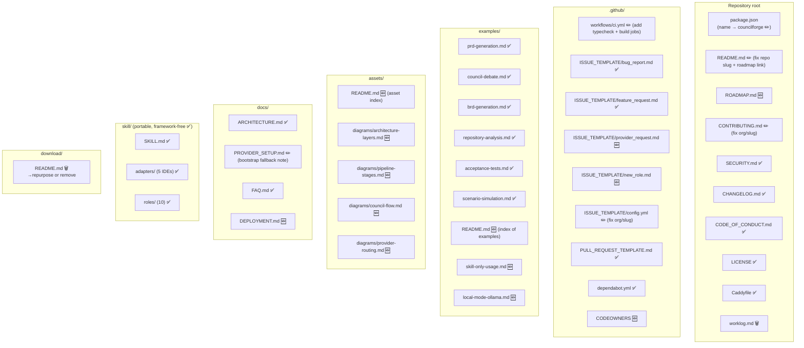

# Design Document: GitHub Repository Launch — CouncilForge

## Overview

CouncilForge is a fully implemented Next.js 16 + TypeScript AI operating system that turns raw source material into decision-ready documents through a visible, multi-role AI Council. The application code — the 29-stage streaming pipeline, the multi-role council, the 4-mode provider router, the knowledge graph, the decision journal, the 38 API routes, the 29 Prisma models, and the portable skill package — is complete and working. This feature covers the **repository packaging and launch-readiness work** required to release CouncilForge as a high-quality GitHub open-source project.

The deliverable is a GitHub-ready repository. The work is entirely structural, documentary, and configuration-level: fixing a scaffolding artifact in `package.json`, filling gaps in GitHub community files, strengthening the CI workflow, adding a standalone roadmap, enriching the examples directory with complete worked examples, adding visual documentation assets, documenting production deployment, cleaning up internal build artifacts, and auditing every cross-reference across the existing docs so nothing points at a file that does not exist.

**Hard constraint:** No application logic is modified. The pipeline, council, provider router, and all `src/lib` domain logic stay exactly as they are. This design must not propose rewriting them. The stable foundation is documented here only so the launch artifacts describe reality accurately.

**Audit reconciliation (important):** The original launch audit assumed several artifacts were missing, but a direct read of the source tree shows they already exist. This design corrects the audit and classifies every item as **create**, **refine**, **verify**, or **remove** so no existing, working file is clobbered.

| Audit claim | Actual state in tree | Classification |
|-------------|----------------------|----------------|
| No `.github/` directory | `.github/` exists with templates, PR template, `dependabot.yml` | Verify / refine |
| No CI workflow | `.github/workflows/ci.yml` exists (but `build-check` job just re-runs lint) | Refine |
| Missing bug/feature issue templates | `bug_report.md`, `feature_request.md`, `config.yml` all exist | Verify |
| Missing provider-request / new-role templates | Absent | Create |
| No CODEOWNERS | Absent | Create |
| No standalone ROADMAP.md | Absent (roadmap only in README) | Create |
| Incomplete examples/ | 6 examples exist; missing skill-only + local-mode worked examples | Refine / create |
| No assets/ directory | Absent | Create |
| `download/README.md` placeholder | Confirmed placeholder ("Here are all the generated files.") | Remove / repurpose |
| `worklog.md` internal build log | Present at repo root | Remove / archive |
| `<your-org>` placeholders | Present in `CONTRIBUTING.md`, `config.yml`, and repo slug drift (`ai-operating-system` vs `councilforge`) | Refine |
| `package.json` name is scaffolding artifact | Confirmed `nextjs_tailwind_shadcn_ts` | Refine |
| Production deployment undocumented | `Caddyfile` exists, no `docs/DEPLOYMENT.md` | Create |
| Provider bootstrap upstream dependency | Real; needs documented fallback | Refine (docs only) |

---

## Architecture

The change set is purely additive or corrective — no application code is modified. The diagram below shows the repository structure after all changes, with each node tagged: ✅ existing (unchanged), ✏️ refined, 🆕 new, 🗑️ removed.



### Design principles for the launch

1. **Reality over aspiration.** Every claim in every doc must be traceable to code that exists. Numbers (29 stages, 23 providers, 38 routes, 29 models, 8 domain packs, 12 tabs) are treated as facts to verify against source, not decoration.
2. **Additive and reversible.** New files and text edits only. The one destructive action (removing `worklog.md` / `download/README.md`) is called out explicitly and gated on confirmation.
3. **One canonical identity.** The repo slug and package name converge on `councilforge`. All `<your-org>/ai-operating-system` references are normalized.
4. **The skill stays framework-free.** Nothing in the launch couples the portable `skill/` package to the app or to any single IDE.
5. **Honest limitations stay visible.** The README's "Known Limitations" section is a feature, not a bug; the launch preserves and cross-links it rather than hiding it.

---

## Components and Interfaces

Each "component" below is a repository artifact. Its "interface" is the contract it must satisfy — file location, required structure, and cross-references it participates in.

### Component 1: `package.json` identity fix

**Purpose:** Remove the scaffolding artifact name so the published package identity matches the product.

**Change:**
```diff
- "name": "nextjs_tailwind_shadcn_ts",
+ "name": "councilforge",
```

**Responsibilities:**
- Rename `name` only. Do not touch `version`, `scripts`, `dependencies`, or `devDependencies` — the build/start/db scripts are working and out of scope.
- Confirm no other file imports the old package name (it is a private app, so nothing should).

**Constraint:** `"private": true` stays; this is an app, not a published npm library.

### Component 2: CI workflow (`.github/workflows/ci.yml`)

**Purpose:** Turn the current lint-only CI (whose second job just re-runs lint) into a real quality gate for a public repo.

**Interface (jobs after refinement):**
```
CI (on: push→main, pull_request→main)
├── lint          → bun install --frozen-lockfile → bun run lint
├── typecheck     → bun install --frozen-lockfile → bunx tsc --noEmit   (new)
└── build         → bun install --frozen-lockfile → bun run db:generate → bun run build (new)
```

**Responsibilities:**
- Preserve the existing `concurrency` cancel-in-progress group and the Bun + Node setup + cache steps.
- Replace the placeholder `build-check` job (which currently re-runs lint) with a genuine `typecheck` job and a `build` job.
- Because `CONTRIBUTING.md` notes pre-existing TypeScript errors in legacy files, the `typecheck` job runs `tsc --noEmit` in **report-only / non-blocking** mode (`continue-on-error: true`) initially, with a comment explaining the intent to tighten it once legacy errors are cleared. The `lint` and `build` jobs are blocking.
- The `build` job runs `db:generate` first (Prisma client must exist before `next build`) and provides a dummy `DATABASE_URL` env for SQLite so the build does not require secrets.

**Constraint:** CI must be runnable by any forked contributor with **no secrets**. No provider API keys, no live generation. Free/local execution is never invoked in CI.

### Component 3: Issue templates (`.github/ISSUE_TEMPLATE/`)

**Purpose:** Complete the community intake surface. Two of four exist; add the two domain-specific ones the audit called for.

**Existing (verify only):** `bug_report.md`, `feature_request.md`, `config.yml`.

**New — `provider_request.md`:** Structured request to add or override an LLM provider. Front-matter labels: `provider, needs-triage`. Sections: provider name + homepage, OpenAI-compatible base URL, free/trial/premium category, default model + context window, auth notes, which pipeline stage class it suits (low-latency / large-context / quality-critical), and a checkbox confirming it is in or absent from `cheahjs/free-llm-api-resources`. Links to `CONTRIBUTING.md → "How to add a new provider"`.

**New — `new_role.md`:** Structured request to add a council role. Front-matter labels: `council-role, needs-triage`. Sections: role name + emoji, mandate, what it challenges, the 6 debate questions it answers, whether it is domain-specific (which domain pack), and the 5-touchpoint checklist from `CONTRIBUTING.md → "How to add a new council role"`.

**Responsibilities:** Match the tone and front-matter shape of the existing templates. Every `CONTRIBUTING.md` cross-reference must resolve to a real heading.

### Component 4: PR template & `CODEOWNERS`

**Purpose:** PR template exists and is good (verify only). Add `CODEOWNERS` so reviews auto-route.

**New — `.github/CODEOWNERS`:** Maps path globs to owners. Structure (owners filled with the org/team handle chosen at launch):
```
*                       @<org>/maintainers
/src/lib/pipeline.ts    @<org>/pipeline-owners
/src/lib/provider-*.ts  @<org>/provider-owners
/skill/                 @<org>/skill-owners
/docs/                  @<org>/docs-owners
/.github/               @<org>/maintainers
```

**Responsibilities:** Use placeholder team handles only if the real org is unknown; flag that the `<org>` token must be replaced before the repo goes public (see Correctness Properties).

### Component 5: `ROADMAP.md` (standalone)

**Purpose:** Promote the roadmap from a README subsection to a first-class, linkable document.

**Interface / structure:**
- **Now (v1.0.0)** — shipped feature set (mirror README summary, link to `CHANGELOG.md`).
- **Next** — auth & multi-tenancy (NextAuth), API-key encryption at rest, PostgreSQL production path.
- **Later** — real-time collaboration, vector memory, more domain packs, plugin marketplace, benchmark/golden-set suite.
- **Explicitly out of scope / non-goals** — anything that would misrepresent the project.
- A short "How priorities are set" note pointing to Discussions.

**Responsibilities:** Content is derived from the README "Roadmap" and "Known Limitations" sections so the two never contradict. README's roadmap section is trimmed to a summary that links to `ROADMAP.md`.

### Component 6: `examples/` enrichment

**Purpose:** Ensure every headline capability has a complete worked example (input + configuration + expected behavior + representative output).

**Existing (verify structure & cross-links):** `prd-generation.md`, `brd-generation.md`, `council-debate.md`, `repository-analysis.md`, `acceptance-tests.md`, `scenario-simulation.md`. Also `examples/websocket/` (pre-existing sample code — leave as-is, not part of the doc example set).

**New:**
- `examples/README.md` — an index table mapping each example to the capability and doc type it demonstrates, with a "start here" pointer.
- `examples/skill-only-usage.md` — running the council purely from the portable `skill/` package inside an AI IDE (no app), referencing `skill/adapters/*` and `skill/examples/sample-input.md`.
- `examples/local-mode-ollama.md` — end-to-end run in `local` mode against an Ollama endpoint, air-gapped, linking `docs/PROVIDER_SETUP.md`.

**Worked-example contract (every example file must contain):**
1. Title + one-line purpose.
2. **Input** — the exact source material to paste (fenced).
3. **Configuration** — source type, doc type, provider mode, domain pack, council depth, output format (table).
4. **Expected Output** — sections produced, at least one representative Mermaid diagram or table, and `Confirmed`/`Inferred`/`Assumption` labeling where relevant.
5. **Explanation** — why the engine behaved that way (which stages, which routing, why the doc type was chosen).

The existing `prd-generation.md` already matches this contract and is the reference exemplar; new examples must conform to it.

### Component 7: `assets/` directory

**Purpose:** Provide visual documentation the README and docs can reference, without binary screenshots at launch (Mermaid/ASCII first; screenshots can be added later).

**New:**
- `assets/README.md` — index of available diagrams and how docs reference them.
- `assets/diagrams/architecture-layers.md` — the 7-layer stack as a Mermaid/ASCII diagram (source of truth for the README's ASCII block).
- `assets/diagrams/pipeline-stages.md` — the 29 stages grouped into the 7 visible phases (Mermaid flowchart).
- `assets/diagrams/council-flow.md` — Round 1 → Round 2 → Moderator → AI voting sequence diagram.
- `assets/diagrams/provider-routing.md` — the 4-mode routing + fallback-chain decision diagram.

**Responsibilities:** Diagrams must match `docs/ARCHITECTURE.md` exactly (same stage names, same layer names). Where the README embeds an ASCII diagram, `assets/` holds the canonical version and the README links to it.

### Component 8: `docs/DEPLOYMENT.md`

**Purpose:** Document the production deployment path that the existing `Caddyfile` implies but no doc explains.

**Interface / sections:**
- Prerequisites (Bun/Node, a reverse proxy).
- Build & run (`bun run build`, standalone output, `bun run start`).
- Reverse proxy with the existing `Caddyfile` (TLS, headers, proxy to port 3000).
- Switching Prisma from SQLite to PostgreSQL for production (env var, `db:push`/migrate).
- Provider mode recommendations for production (`own-keys` or `local`) and the API-key-at-rest limitation (link `SECURITY.md`).
- Environment variables reference (`.env`).

**Responsibilities:** Reference only scripts that exist in `package.json`. Do not invent deployment tooling.

### Component 9: Cleanup — `worklog.md` and `download/README.md`

**Purpose:** Remove internal build noise before public release.

- `worklog.md` — internal build log. **Remove** (or move under an ignored `.internal/` path). This is the one potentially destructive action and is gated on user confirmation before deletion.
- `download/README.md` — placeholder ("Here are all the generated files."). Either repurpose into a real explanation of the in-app export/download feature or remove the directory if it serves no runtime purpose. Verify no code references `download/` before removing.

### Component 10: Cross-reference & identity normalization

**Purpose:** Every relative link resolves; every external repo URL uses one consistent slug.

**Responsibilities:**
- Replace `<your-org>/ai-operating-system` with the chosen `<org>/councilforge` across `CONTRIBUTING.md`, `.github/ISSUE_TEMPLATE/config.yml`, and any other doc.
- Confirm every relative Markdown link (e.g. `./docs/FAQ.md`, `./skill/SKILL.md`, `../CONTRIBUTING.md`) points to an existing file.
- Confirm README references to `skill/workflows/`, `skill/templates/`, `skill/validators/` resolve (these directories are referenced by `SKILL.md` and must exist in the tree).

### Portable skill compatibility layer & AI IDE integration

The `skill/` package is a **framework-free, pure-Markdown** distillation of the same council, workflows, templates, validators, and provider routing rules used by the app. The launch treats it as a stable, first-class deliverable and does **not** modify its logic. Launch responsibilities for the skill are documentary only:

- **Adapters** (`skill/adapters/`): five IDE setup guides — Claude Code (`CLAUDE.md` include), Cursor (`.cursorrules`), Codex (`AGENTS.md`), Kiro (`.kiro/steering/*.md`), GitHub Copilot (`.github/copilot-instructions.md`). Verify each adapter's install steps reference files that exist.
- **Compatibility matrix** (`skill/COMPATIBILITY.md`): verify it states minimum model context (≥32K) and JSON-mode requirement consistently with `SKILL.md`.
- **Install validation**: the skill's own smoke test (run `skill/examples/sample-input.md`, diff against `skill/examples/sample-output-prd.md`) is referenced from the new `examples/skill-only-usage.md`.
- **Consistency check**: `SKILL.md` claims 10 roles / 10 workflows / (6 or 8) templates. The launch verifies these counts against the actual `skill/` subdirectories and reconciles any mismatch in the docs (a known drift: `SKILL.md` §5 says 6 templates while README says 8 — this must be resolved to one true number).

---

## Data Models

The "data models" for a documentation launch are the structural contracts each artifact must satisfy. They are validated by the Testing Strategy below.

### Model: Issue-template front matter

```yaml
# Required front matter for every file in .github/ISSUE_TEMPLATE/*.md
name: string        # human-readable template name
about: string       # one-line description shown in the chooser
title: string       # default title prefix, e.g. "[provider] "
labels: string      # comma-separated, must include "needs-triage"
assignees: string   # may be empty ("")
```

### Model: Worked-example document

```
ExampleDoc {
  title:          H1 heading
  purpose:        one-line summary
  input:          fenced code block (source material)
  configuration:  table { source, docType, providerMode, domainPack, councilDepth, outputFormat }
  expectedOutput: section list + >=1 (mermaid diagram | table)
  explanation:    prose tying behavior to specific stages/routing
}
```

### Model: CI workflow contract

```
CIWorkflow {
  triggers:     [push:main, pull_request:main]
  concurrency:  cancel-in-progress by ref
  secrets:      none        # invariant: CI must pass on a fork with zero secrets
  jobs: {
    lint:      { blocking: true }
    typecheck: { blocking: false }   # continue-on-error until legacy TS errors cleared
    build:     { blocking: true, needs: [db:generate] }
  }
}
```

### Model: Repository identity

```
Identity {
  packageName: "councilforge"          # package.json
  repoSlug:    "<org>/councilforge"    # all docs, one consistent value
  displayName: "CouncilForge"          # README, prose
  license:     "MIT"                    # LICENSE + README badge agree
}
```

### Model: Cross-reference graph

```
Link {
  source:  file path
  target:  file path | external URL | heading anchor
  kind:    relative-file | external-repo | anchor
}
Invariant: for every kind=relative-file Link, target exists on disk.
Invariant: for every kind=external-repo Link, slug == Identity.repoSlug.
```

### Claim ↔ reality map (verified counts)

These figures appear across README, `docs/ARCHITECTURE.md`, and `SKILL.md`. Each must be checked against source before launch; the design records the asserted values and their source of truth.

| Claim | Asserted | Source of truth |
|-------|----------|-----------------|
| Pipeline stages | 29 | `STAGE_ORDER` in `src/lib/pipeline.ts` |
| Providers | 23 | `PROVIDER_CATALOG` in `src/lib/provider-catalog.ts` |
| API routes | 38 | route files under `src/app/api/` |
| Prisma models | 29 | `prisma/schema.prisma` |
| Domain packs | 8 | `src/lib/domain-packs.ts` |
| UI tabs | 12 | `src/app/page.tsx` |
| Skill roles | 10 | `skill/roles/*.md` |
| Skill templates | 6 vs 8 (drift) | `skill/templates/*.md` — resolve |

---

## Correctness Properties

These are the invariants the launch must uphold. They are the acceptance backbone for the tasks phase.

**Property 1: No broken internal links.** For every relative Markdown link in any tracked `.md` file, the target file exists on disk. (`∀ link ∈ relativeLinks : exists(resolve(link))`)

**Property 2: All referenced files exist.** Every file named in README, `CONTRIBUTING.md`, `docs/*`, and `SKILL.md` (e.g. `skill/workflows/`, `skill/templates/`, adapters, examples) is present in the repository.

**Property 3: Consistent repository identity.** `package.json.name == "councilforge"`, and every external repo URL uses the same `<org>/councilforge` slug. No `nextjs_tailwind_shadcn_ts` and no `ai-operating-system` references remain.

**Property 4: Docs match reality.** Every quantitative claim (29 stages, 23 providers, 38 routes, 29 models, 8 packs, 12 tabs, role/template counts) equals the count in its source of truth. Any discrepancy is fixed in the doc, never by touching code.

**Property 5: No unsupported claims.** No doc asserts a capability the code does not have. Existing honest limitations (single-user, unencrypted keys at rest, SQLite default, lexical memory, free-tier ceilings, no E2E suite, upstream provider dependency) remain documented and are not overwritten by marketing language.

**Property 6: CI is fork-safe.** The CI workflow passes on a fresh fork with zero configured secrets; it never requires a provider key or performs a live generation.

**Property 7: Community intake is complete.** `.github/ISSUE_TEMPLATE/` contains bug, feature, provider-request, and new-role templates; each has valid front matter and resolvable `CONTRIBUTING.md` cross-references. A PR template and `CODEOWNERS` exist.

**Property 8: The skill stays framework-free.** No file under `skill/` gains a dependency on the Next.js app, a vendor SDK, or a specific IDE. Adapters remain optional overlays.

**Property 9: Additivity.** No change alters `src/`, `prisma/schema.prisma`, or the runtime behavior of the application. The diff touches only docs, `.github/`, `assets/`, `examples/`, `package.json` (name field), and removed build noise.

**Property 10: Every headline capability has an example.** Each capability advertised in the README feature table maps to at least one file under `examples/` or a clearly linked section.

---

## Error Handling

Because this is a packaging effort, "errors" are launch-blocking defects and the risks introduced by the underlying system. Each has a defined response.

### Scenario 1: Broken link discovered

**Condition:** A relative link resolves to a missing file, or a claimed directory (e.g. `skill/workflows/`) is absent.
**Response:** Fix the link or create/verify the target. If the target genuinely should not exist, remove the reference. Never ship a dangling link.
**Recovery:** Re-run the link check (Testing Strategy) until clean.

### Scenario 2: Claim ↔ code mismatch

**Condition:** A doc says "23 providers" but the catalog has a different count.
**Response:** Update the **doc** to the true count. Do not modify code to match the doc.
**Recovery:** Update the Claim ↔ reality map and re-verify.

### Scenario 3: Provider registry bootstrap upstream drift (runtime)

**Condition:** `cheahjs/free-llm-api-resources` changes schema or removes providers, breaking `/api/providers/bootstrap`.
**Response:** This is an existing runtime limitation, not something the launch fixes in code. The launch **documents** it: `docs/PROVIDER_SETUP.md` gains a "Bootstrap fallback" note explaining that the last successful catalog is persisted in `ProviderEntry`/`AppSettings`, that manual provider entry via `POST /api/providers/keys` always works, and how to pin/refresh the registry. The README "Known Limitations" already lists this dependency; keep it.
**Recovery:** Users fall back to the persisted catalog or manual entry; no data loss.

### Scenario 4: CI failure on a fork

**Condition:** The `build` job fails because Prisma client wasn't generated or `DATABASE_URL` is unset.
**Response:** The `build` job runs `db:generate` and sets a dummy SQLite `DATABASE_URL` in-job so it is self-contained. The `typecheck` job is non-blocking to accommodate documented pre-existing legacy TS errors.
**Recovery:** Contributor sees a green `lint` + `build` and an informational `typecheck`.

### Scenario 5: Destructive cleanup on a needed file

**Condition:** Removing `worklog.md` or `download/README.md` deletes something referenced by code or docs.
**Response:** Before deletion, grep the tree for references. `worklog.md` deletion is gated on explicit user confirmation. `download/` is verified against runtime code (the export feature writes to it?) before removal; if used, repurpose the README instead of deleting.
**Recovery:** Deletion is a git-tracked change and fully reversible via revert.

### Scenario 6: Org/owner placeholders shipped public

**Condition:** `<org>` / `<your-org>` tokens remain in `CODEOWNERS`, `config.yml`, or links at publish time.
**Response:** A pre-publish checklist item (and Correctness Property #3) requires resolving every placeholder to the real org/team before the repo is made public.
**Recovery:** Search for `<org>` / `<your-org>` and replace; re-run link check.

---

## Testing Strategy

Testing here means **verifying the repository artifacts**, not the application runtime. No property-based testing library is needed; the checks are structural and deterministic.

### Structural / static checks (primary)

- **Link check.** Run a Markdown link checker (e.g. `lychee` or `markdown-link-check`) across all `.md` files, offline mode for relative links. Every relative link must resolve. This can be added as an optional CI job (non-blocking initially).
- **File-existence check.** For each file/directory named in README, `CONTRIBUTING.md`, `SKILL.md`, and `docs/*`, assert presence on disk.
- **Front-matter validation.** Every `.github/ISSUE_TEMPLATE/*.md` has the required front-matter keys (Model: Issue-template front matter).
- **Identity grep.** Assert zero occurrences of `nextjs_tailwind_shadcn_ts`, `ai-operating-system`, `<your-org>`, and `<org>` in tracked files at publish time.
- **Claim verification.** For each row in the Claim ↔ reality map, count the source of truth and compare to the doc figure.

### CI validation

- Confirm `.github/workflows/ci.yml` runs `lint` (blocking), `typecheck` (informational), and `build` (blocking) with no secrets, on a clean checkout.
- Confirm the `build` job produces the Next.js standalone output using the existing `bun run build` script.

### Example validation (manual, spot-check)

- For each new `examples/*.md`, confirm it satisfies the worked-example contract (input + configuration + expected output + explanation) and that its cross-links resolve.
- Optionally run `examples/skill-only-usage.md` through an IDE adapter and diff against `skill/examples/sample-output-prd.md` to confirm the documented flow still works.

### Application testing (explicitly out of scope)

The app already ships without an automated E2E/screenshot suite (documented limitation). Building one is on the roadmap, not part of this launch. The launch must not claim a test suite that does not exist.

---

## Performance Considerations

Not applicable to the artifacts themselves. The launch preserves the app's existing runtime performance profile (documented in README FAQ: ~45s–15min per run depending on mode). The only performance-adjacent addition is CI runtime: the new `typecheck` and `build` jobs increase CI duration, mitigated by the existing `node_modules` + `.next/cache` caching and `concurrency` cancellation.

---

## Security Considerations

- **No secrets in CI.** The workflow must never require or embed provider API keys (Correctness Property #6).
- **Preserve honest security posture.** `SECURITY.md` and the README "Known Limitations" already disclose that API keys are stored unencrypted at rest and that deployment is single-user. The launch keeps these disclosures and cross-links them from `docs/DEPLOYMENT.md`. It must not soften or hide them.
- **Redaction reminders.** Issue and PR templates already instruct contributors to redact keys from logs/screenshots; verify these reminders remain.
- **No secret leakage in examples.** Example inputs/outputs use fictional data (e.g. the "Cadence" habit tracker) — no real keys, endpoints, or PII.

---

## Dependencies

**Existing (unchanged):** Next.js 16, TypeScript 5, Bun runtime, Prisma 6 + SQLite/PostgreSQL, shadcn/ui, Tailwind 4, Zustand, `z-ai-web-dev-sdk`, `mermaid`, and the full dependency set in `package.json`. None are added or removed by this launch.

**External references (documentary):**
- `cheahjs/free-llm-api-resources` — upstream source for the provider registry; the launch documents the fallback path but does not depend on it at build time.
- IDE hosts (Claude Code, Cursor, Codex, Kiro, GitHub Copilot) — targets of the skill adapters; each is optional.

**Tooling introduced (CI-only, optional):**
- A Markdown link checker (`lychee` or `markdown-link-check`) for the link-check job.
- GitHub Actions runners (`actions/checkout`, `actions/setup-node`, `oven-sh/setup-bun`, `actions/cache`) — already used by the existing workflow.

---

## Stable vs Experimental (honest limitations)

To keep the launch honest, the design classifies what is stable versus what is explicitly not, so docs never overpromise.

| Area | Status | Note for docs |
|------|--------|---------------|
| 29-stage pipeline, council, provider router | **Stable** | Core, unchanged, well-documented |
| Portable skill package | **Stable** | Framework-free; adapters optional |
| SQLite single-user default | **Stable (with caveat)** | Fine for single user; Postgres for production |
| Provider registry bootstrap | **Experimental dependency** | Relies on upstream repo; fallback documented |
| API-key encryption at rest | **Not implemented** | Documented limitation; on roadmap |
| Auth & multi-tenancy | **Not implemented** | Roadmap item; docs say single-user only |
| Vector/semantic memory | **Not implemented** | Current recall is lexical; roadmap item |
| Automated E2E / benchmark suite | **Not implemented** | Manual exercise today; roadmap item |
| Screenshots in `assets/` | **Deferred** | Launch ships Mermaid/ASCII; screenshots later |

This table feeds directly into `ROADMAP.md` (Now/Next/Later) and preserves the README "Known Limitations" section verbatim in spirit.
