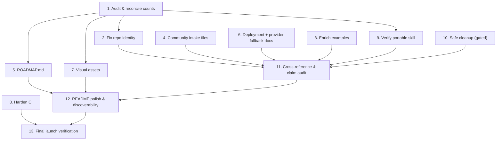

# Implementation Plan: GitHub Repository Launch — CouncilForge

## Overview

This plan turns the design and requirements into an ordered, verifiable set of packaging tasks. Every task is documentary, structural, or configuration-level. **No task modifies `src/` or `prisma/schema.prisma`** (Requirement 11). Each task references the requirements it satisfies.

Working root: the CouncilForge repository (the extracted project tree). Tasks 2–10 are largely independent and can run in parallel after the Task 1 audit; Tasks 11–13 are verification gates that depend on the earlier work.

## Task Dependency Graph



```json
{
  "waves": [
    { "wave": 1, "tasks": ["1"] },
    { "wave": 2, "tasks": ["2", "3", "4", "5", "6", "7", "8", "9", "10"] },
    { "wave": 3, "tasks": ["11"] },
    { "wave": 4, "tasks": ["12"] },
    { "wave": 5, "tasks": ["13"] }
  ]
}
```

## Tasks

- [ ] 1. Audit and reconcile: verify current state against claims
  - Enumerate the actual tree and confirm which audited items already exist (`.github/`, issue templates, PR template, `dependabot.yml`, `ci.yml`, the six examples) versus which are genuinely missing.
  - Produce a written gap list (complete / partial / missing / schema-only / stable vs experimental) saved as a scratch note for the launch PR description.
  - Count the source-of-truth values and record them: `STAGE_ORDER` length in `src/lib/pipeline.ts`, `PROVIDER_CATALOG` length in `src/lib/provider-catalog.ts`, route files under `src/app/api/`, models in `prisma/schema.prisma`, packs in `src/lib/domain-packs.ts`, tabs in `src/app/page.tsx`, files in `skill/roles/`, `skill/workflows/`, `skill/templates/`.
  - Record the verified counts in a claim↔reality table for use by later tasks.
  - _Requirements: 9.3, 9.4, 11.2, 11.3_

- [ ] 2. Fix repository identity
  - [ ] 2.1 Rename the package
    - Change `package.json` `name` from `nextjs_tailwind_shadcn_ts` to `councilforge`; leave `version`, `scripts`, `dependencies`, `devDependencies`, and `"private": true` untouched.
    - _Requirements: 1.1, 1.2, 1.3_
  - [ ] 2.2 Normalize repo slug and org tokens
    - Replace every `ai-operating-system` repo slug and `<your-org>` reference with a single consistent `<org>/councilforge` slug across `CONTRIBUTING.md`, `.github/ISSUE_TEMPLATE/config.yml`, README, and any other doc.
    - Grep the tree to confirm zero occurrences of `nextjs_tailwind_shadcn_ts` and zero `ai-operating-system` repo slugs remain.
    - _Requirements: 1.4, 1.5, 1.6_

- [ ] 3. Harden the CI workflow (fork-safe)
  - Refine `.github/workflows/ci.yml`: keep the `push→main` / `pull_request→main` triggers, the `concurrency` cancel-in-progress group, and the Bun/Node setup + cache steps.
  - Keep the blocking `lint` job (`bun run lint`).
  - Replace the placeholder `build-check` job with a genuine `build` job that runs `bun run db:generate` then `bun run build`, with a dummy SQLite `DATABASE_URL` set in-job; mark it blocking.
  - Add a `typecheck` job running `bunx tsc --noEmit` as non-blocking (`continue-on-error: true`) with a comment explaining it will be tightened once legacy TS errors are cleared.
  - Confirm no job requires a secret or performs a live generation.
  - _Requirements: 2.1, 2.2, 2.3, 2.4, 2.5, 2.6, 2.7_

- [ ] 4. Complete the community intake surface
  - [ ] 4.1 Add the provider-request issue template
    - Create `.github/ISSUE_TEMPLATE/provider_request.md` with valid front matter (labels include `needs-triage`) and sections for provider name/homepage, OpenAI-compatible base URL, category, default model + context window, auth notes, suited stage class, and a `cheahjs/free-llm-api-resources` presence checkbox; link the `CONTRIBUTING.md → "How to add a new provider"` heading.
    - _Requirements: 3.1, 3.2, 3.4, 3.5_
  - [ ] 4.2 Add the new-role issue template
    - Create `.github/ISSUE_TEMPLATE/new_role.md` with valid front matter (labels include `needs-triage`) and sections for role name + emoji, mandate, what it challenges, the 6 debate questions, domain-specificity, and the 5-touchpoint checklist; link the `CONTRIBUTING.md → "How to add a new council role"` heading.
    - _Requirements: 3.1, 3.3, 3.4, 3.5_
  - [ ] 4.3 Add CODEOWNERS and verify existing files
    - Create `.github/CODEOWNERS` mapping root, `src/lib/pipeline.ts`, `src/lib/provider-*.ts`, `skill/`, `docs/`, and `.github/` to owner handles (placeholder team handles flagged for replacement).
    - Verify `bug_report.md`, `feature_request.md`, `config.yml`, the PR template, and `dependabot.yml` all have valid front matter / structure and resolvable cross-references; do not degrade them.
    - _Requirements: 3.6, 3.7, 3.4, 3.5_

- [ ] 5. Create the standalone ROADMAP.md
  - Create `ROADMAP.md` with "Now (v1.0.0)" (linking `CHANGELOG.md`), "Next", "Later", and "Non-goals / out of scope" sections, derived from the design's Stable-vs-Experimental table so unimplemented items (auth/multi-tenancy, key encryption at rest, vector memory, E2E suite) appear as planned, not present.
  - Trim the README roadmap subsection to a summary that links to `ROADMAP.md`; verify the two do not contradict.
  - _Requirements: 4.1, 4.2, 4.3, 4.4, 4.5, 4.6_

- [ ] 6. Add production deployment and provider-fallback docs
  - [ ] 6.1 Write docs/DEPLOYMENT.md
    - Create `docs/DEPLOYMENT.md` covering prerequisites, build & run (`bun run build` standalone, `bun run start`), reverse proxy via the existing `Caddyfile`, SQLite→PostgreSQL switch, production provider-mode recommendations, and an env-var reference; reference only scripts that exist in `package.json`; cross-link and do not soften the API-key-at-rest limitation in `SECURITY.md`.
    - _Requirements: 7.1, 7.2, 7.3, 7.4_
  - [ ] 6.2 Add the bootstrap-fallback note
    - Add a "Bootstrap fallback" note to `docs/PROVIDER_SETUP.md` explaining that the last successful catalog persists in `ProviderEntry`/`AppSettings`, that manual provider entry always works, and how to pin/refresh the registry if upstream drifts.
    - _Requirements: 7.5_

- [ ] 7. Create visual documentation assets
  - Create `assets/README.md` (index of diagrams and how docs reference them).
  - Create `assets/diagrams/architecture-layers.md` (7-layer stack), `assets/diagrams/pipeline-stages.md` (verified stage count grouped into 7 phases), `assets/diagrams/council-flow.md` (Round 1 → Round 2 → Moderator → AI voting), and `assets/diagrams/provider-routing.md` (4-mode routing + fallback), all in Mermaid/ASCII.
  - Ensure diagram stage/layer names match `docs/ARCHITECTURE.md` exactly; link the canonical diagram from the README's ASCII block.
  - _Requirements: 6.1, 6.2, 6.3, 6.4, 6.5_

- [ ] 8. Enrich the examples set
  - [ ] 8.1 Add the examples index
    - Create `examples/README.md` mapping each example to the capability and doc type it demonstrates, with a "start here" pointer; ensure each README feature-table capability maps to at least one example.
    - _Requirements: 5.1, 5.7_
  - [ ] 8.2 Add the skill-only usage example
    - Create `examples/skill-only-usage.md` satisfying the worked-example contract, referencing `skill/adapters/*`, `skill/examples/sample-input.md`, and the diff-against-`sample-output-prd.md` smoke test.
    - _Requirements: 5.2, 5.4, 5.6, 10.4_
  - [ ] 8.3 Add the local-mode example
    - Create `examples/local-mode-ollama.md` satisfying the worked-example contract for an air-gapped `local`-mode run, linking `docs/PROVIDER_SETUP.md`.
    - _Requirements: 5.3, 5.4, 5.6_
  - [ ] 8.4 Verify existing examples conform
    - Confirm `prd-generation.md`, `brd-generation.md`, `council-debate.md`, `repository-analysis.md`, `acceptance-tests.md`, and `scenario-simulation.md` satisfy the worked-example contract and use fictional data only; leave `examples/websocket/` unchanged.
    - _Requirements: 5.4, 5.5, 5.6_

- [ ] 9. Verify the portable skill stays framework-free
  - Confirm no file under `skill/` gains a dependency on the app, a vendor SDK, or a specific IDE.
  - Verify each `skill/adapters/*` guide (Claude Code, Cursor, Codex, Kiro, GitHub Copilot) references only files that exist.
  - Verify `skill/COMPATIBILITY.md` states the ≥32K context and JSON-mode requirement consistently with `SKILL.md`.
  - Reconcile `SKILL.md`'s asserted counts (10 roles / 10 workflows / templates) against the actual `skill/` subdirectories; resolve the 6-vs-8 template drift to one true value.
  - _Requirements: 10.1, 10.2, 10.3, 10.5, 9.4_

- [ ] 10. Safe cleanup of build noise (gated)
  - Grep the tree for references to `worklog.md`; propose removal (or move under an ignored `.internal/` path) and gate deletion on explicit user confirmation.
  - Verify no runtime code depends on the `download/` directory; if unused, remove or repurpose `download/README.md`; if it backs the in-app export feature, repurpose the README to explain it instead of deleting.
  - Treat all deletions as git-tracked, reversible changes.
  - _Requirements: 8.1, 8.2, 8.3, 8.4, 11.5_

- [ ] 11. Full cross-reference and claim audit
  - Run a Markdown link check across all tracked `.md` files; fix or remove every dangling relative link so all targets exist on disk.
  - Verify every file/directory named in README, `CONTRIBUTING.md`, `SKILL.md`, and `docs/*` (including `skill/workflows/`, `skill/templates/`, `skill/validators/`, adapters, examples) is present.
  - Reconcile every quantitative claim against the verified counts from Task 1; fix discrepancies in docs only.
  - Confirm the honest-limitations section remains intact and no unsupported capability claims exist.
  - _Requirements: 9.1, 9.2, 9.3, 9.5, 9.6_

- [ ] 12. README polish and discoverability
  - Ensure the README opens with a one-sentence description, who it is for, why it exists, and the problem it solves; and explains the council, provider routing, free + BYOK support, memory/validation/traceability, and what makes it different.
  - Naturally weave in honest search keywords (AI Council, multi-agent, requirements intelligence, PRD/BRD/SOW, document generation, provider routing, knowledge graph, traceability, validation, AI IDE, agent workflow, decision intelligence, repository analysis) without stuffing.
  - Link the new `ROADMAP.md`, `docs/DEPLOYMENT.md`, `assets/` diagrams, and `examples/README.md`; verify all badges and the license claim agree with `LICENSE`.
  - Produce recommended GitHub metadata: repo name, short description, and topics/tags list (documentary output for the maintainer, not a code change).
  - _Requirements: 1.5, 4.5, 6.5, 9.1, 9.5, 9.6_

- [ ] 13. Final launch verification
  - Re-run the identity grep (no `nextjs_tailwind_shadcn_ts`, no `ai-operating-system`; `<org>`/`<your-org>` only where the pre-publish checklist flags them).
  - Re-run the link check and file-existence check; confirm all issue templates have valid front matter and resolvable cross-references.
  - Confirm CI is fork-safe (lint + build blocking, typecheck informational, no secrets).
  - Confirm the diff touches only docs, `.github/`, `assets/`, `examples/`, `package.json` (name), and removed build noise — nothing under `src/` or `prisma/schema.prisma`.
  - Produce a launch checklist and a first-release recommendation (v1.0.0 notes) plus concise "what improved / what remains" lists for the PR description.
  - _Requirements: 1.4, 2.6, 9.1, 9.2, 11.1, 11.2, 11.3, 11.4_

## Notes

- **Additive only.** Every task is confined to docs, `.github/`, `assets/`, `examples/`, the `name` field of `package.json`, and gated build-noise removal. No task edits `src/` or `prisma/schema.prisma` (Requirement 11).
- **One destructive step.** Task 10 (removing `worklog.md`) is gated on explicit user confirmation and is reversible via git.
- **Org placeholder.** `<org>` tokens remain until the maintainer supplies the real GitHub org/username; Task 13 flags any that survive to the pre-publish checklist.
- **Counts are facts.** Tasks 5, 7, 11, and 12 depend on the verified counts recorded in Task 1; docs are corrected to match code, never the reverse (Requirement 9.3).
- **CI stays fork-safe.** No task introduces a secret-dependent CI step (Requirement 2.6).
- Verification in this launch is structural (link checks, file-existence, front-matter, identity grep, claim reconciliation), not property-based application testing, which remains a roadmap item.
