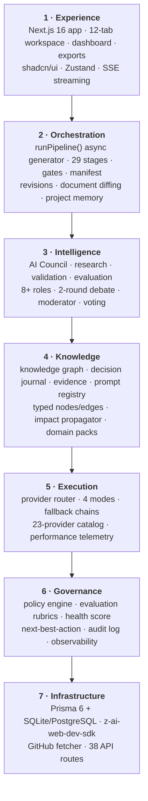

# Architecture — the 7 layers

CouncilForge is organized into seven cooperating layers. Each has one clear responsibility and a small public surface for the layer above it. This mirrors [`docs/ARCHITECTURE.md`](../../docs/ARCHITECTURE.md) exactly.

**Read next:** [`docs/ARCHITECTURE.md`](../../docs/ARCHITECTURE.md) for the full layer breakdown, data flow, DB models, and API surface.
