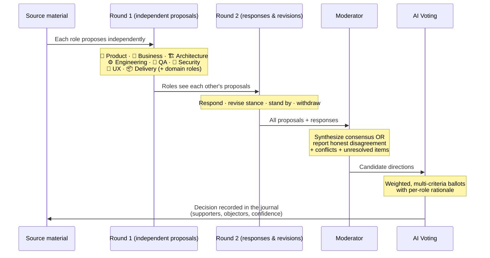

# Council flow — debate to consensus

The AI Council is the core differentiator: a visible, adversarial, multi-role debate instead of a single prompt. This is stages 6–9 of the [pipeline](./pipeline-stages.md).

**Why it matters:** when someone later asks *"why did we pick X over Y?"*, the answer is on the record — the objecting role, the feasibility note, and the moderator's tie-breaker. See the [`council-debate` example](../../examples/council-debate.md).
