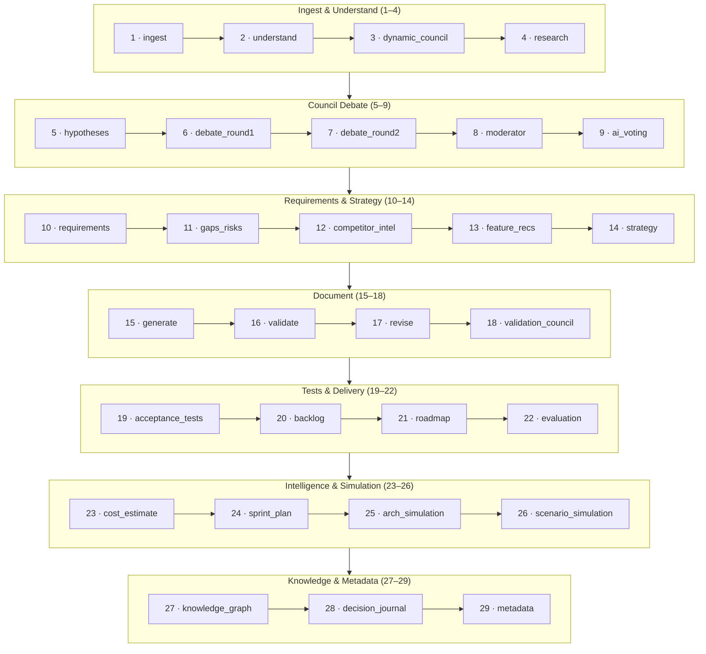

# Pipeline — 29 stages in 7 phases

The pipeline runs 29 stages in `STAGE_ORDER` (see [`src/lib/pipeline.ts`](../../src/lib/pipeline.ts)), streamed live to the browser as SSE events. Stage names below match [`docs/ARCHITECTURE.md`](../../docs/ARCHITECTURE.md) exactly.

Every stage emits `stage_start` / `stage_complete` events; a failure emits `stage_skipped` with a reason and the pipeline degrades gracefully. Stage 17 (`revise`) runs at most once, only when validation gates fail.
