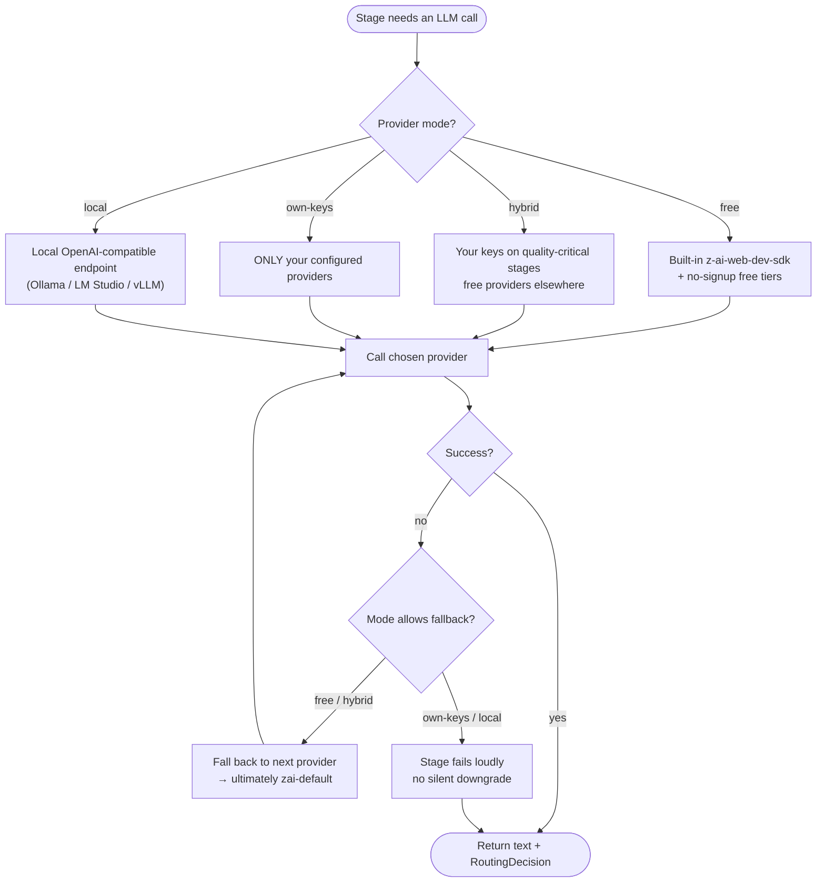

# Provider routing — 4 modes + fallback

The router maps each council role + task type to the best available provider, then executes with an automatic fallback chain. Mode is chosen at onboarding and changeable in the Providers tab. See [`docs/PROVIDER_SETUP.md`](../../docs/PROVIDER_SETUP.md).

Every routed call records a `RoutingDecision` (provider, model, reason, whether it was a fallback) and an observability event, visible in the Providers tab.
