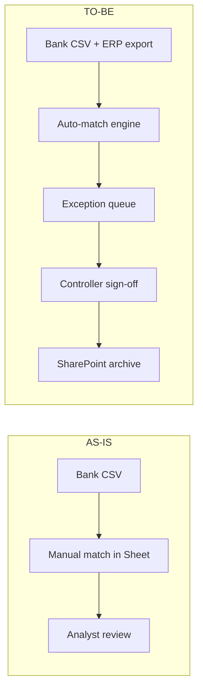

# Example: BRD Generation — Internal Workflow Automation

A self-contained example of producing a Business Requirements Document for an
internal initiative, where the focus is stakeholders, business rules, and
process change rather than UI flows.

## Input

Paste the following brief into the **Text** source panel:

```
Initiative: Replace the spreadsheets used by Finance for monthly vendor
reconciliation with an automated workflow.

Current state:
- 4 analysts spend ~3 days/month each reconciling ~1,200 vendor invoices
  against 3 bank accounts in a shared Google Sheet
- 12% error rate; 1 audit finding last year (duplicate payment of $8,400)

Desired state:
- Workflow ingests bank CSV + ERP vendor export, matches invoices, flags
  exceptions for human review
- Single approver (Controller) signs off; output archived to SharePoint
- Quarterly KPI dashboard for the CFO

Stakeholders: Controller (owner), 4 analysts (users), CFO (sponsor),
IT-Procurement (security review), External Auditor (read-only)
```

## Configuration

| Field            | Value                                       |
| ---------------- | ------------------------------------------- |
| Source           | Text                                        |
| Doc type         | `BRD` (forced — business framing is clear)  |
| Provider mode    | `hybrid` (free reasoning + paid long-context)|
| Domain pack      | `enterprise-finance` (optional)             |
| Council depth    | 2-round debate                              |
| Output format    | Markdown                                    |

## Expected Output

The pipeline produces a **BRD** with the full 12-section BRD structure: Business
Need, Stakeholders & Roles, Current State, Desired State, Business Rules, Process
Changes, Success Metrics, Assumptions, Constraints, Risks, Dependencies, Open
Questions.

A **stakeholder analysis** table is generated:

| Stakeholder      | Role           | Influence | Interest | Engagement strategy          |
| ---------------- | -------------- | --------- | -------- | ---------------------------- |
| CFO              | Sponsor        | High      | High     | Monthly KPI review           |
| Controller       | Owner          | High      | High     | Weekly standup, sign-off     |
| 4 Analysts       | Users          | Medium    | High     | Training + feedback loop     |
| IT-Procurement   | Security       | High      | Medium   | Pre-prod security review     |
| External Auditor | Read-only      | Low       | Medium   | Quarterly export bundle      |

**Business rules** are enumerated with IDs (BR-01 … BR-09), each with a
`Confirmed` / `Inferred` / `Assumption` label, e.g. `BR-04: Duplicate-payment
threshold > $0 auto-flags for Controller review — Confirmed`.

A mermaid **process-change** diagram contrasts AS-IS vs TO-BE lanes:



The **Process changes** section lists 6 deltas (decommission shared sheet,
provision SharePoint site, etc.) with owner + ETA per item.

## Explanation

- **BRD** is forced because the brief is explicitly framed around business need,
  stakeholders, and process change — the AUTO stage would have picked BRD too,
  but forcing it skips one LLM call and removes ambiguity.
- **hybrid mode** routes the long Understand stage to a paid long-context model
  (so the full brief + stakeholder list fits in one call) while the Brainstorm
  and Generate stages run on Groq free-tier. Typical cost: ~$0.02.
- The **businessAnalyst** role leads the BRD draft; the **complianceReviewer**
  role adds the audit-finding risk row; the **moderator** reconciles the two
  into the final business-rules table.
- `Confirmed` labels come from facts stated verbatim in the brief; `Inferred`
  from reasonable extrapolation (e.g. SharePoint archive location); `Assumption`
  flags anything the brief left open (e.g. retention period). These feed the
  completeness validator's "needs human sign-off" report.
- The output is reviewable in the **Document** tab, exportable as Markdown or
  CSV (for the business-rules table alone), and versioned in the project sidebar.
