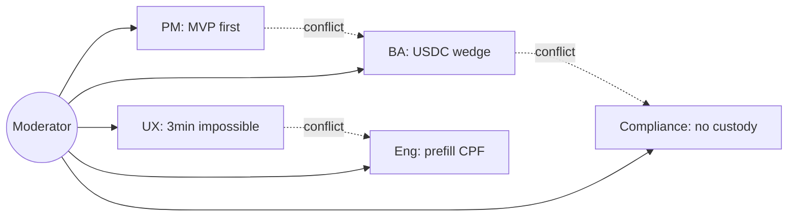

# Example: Council Debate — Fintech App Brief

A self-contained example of exercising the multi-role council debate on a
fintech brief, in **hybrid** mode, surfacing conflicts and the moderator's
consensus.

## Input

Paste into the **Text** source panel:

```
Build a mobile-first P2P payments app for the Latin American market
(starting in Brazil, then Mexico).

Key behaviors:
- Onboarding in <3 minutes via CPF/CNPJ + selfie liveness check
- Send/receive in BRL via Pix instant-payment rails
- Wallet top-up via credit card or bank slip
- Optional USD stablecoin balance (USDC) for remittances
- In-app savings goal with daily round-up

Constraints:
- Must be licensed by Banco Central do Brasil (BCB) — SCD or SPE
- PCI-DSS Level 1 for card data
- Data residency: Brazilian user data must stay in Brazilian AWS region
- <500ms P95 transaction confirmation
```

## Configuration

| Field            | Value                                                |
| ---------------- | ---------------------------------------------------- |
| Source           | Text                                                 |
| Doc type         | `AUTO`                                               |
| Provider mode    | `hybrid` (free Brainstorm + paid long-context Understand) |
| Council depth    | 2-round debate                                       |
| Output format    | Markdown                                             |

## Expected Output

The **Brainstorm** stage runs the **8 core roles** in parallel:

| Role                  | Headline argument                                   |
| --------------------- | --------------------------------------------------- |
| productManager        | Ship MVP = Pix send/receive + onboarding; defer USDC |
| businessAnalyst       | USDC remittance is the wedge vs Nubank/PicPay       |
| solutionsArchitect    | Pix is real-time; USDC needs an off-chain settlement layer |
| engineeringLead       | P95 < 500ms only if Pix is synchronous + cache       |
| qaLead                | Liveness-check false-positive rate must be < 0.5%    |
| securityReviewer      | PCI scope: don't store PAN — use network-tokenization |
| uxReviewer            | 3-minute onboarding is unrealistic with liveness     |
| complianceReviewer    | BCB SCD license prohibits custodying user funds      |

**Round 2** surfaces **2 conflicts**:

1. **USDC inclusion vs BCB licensing** — `businessAnalyst` argues it's the
   differentiator; `complianceReviewer` argues SCD license forbids stablecoin
   custody. Moderator resolves: ship USDC as a **partner integration** (Bitso
   white-label) so CouncilForge's licensee doesn't custody funds.
2. **Onboarding time vs liveness check** — `uxReviewer` says 3 minutes is
   impossible; `engineeringLead` proposes pre-filling CPF from device. Moderator
   resolves: target 4 minutes, escalate the 3-minute goal to `Assumption`.

The **moderator consensus** is a structured Markdown block:

```markdown
## Moderator Consensus
- MVP scope: Pix send/receive, onboarding, savings-goal. (Confirmed)
- USDC via partner integration, not in-house custody. (Confirmed)
- Onboarding target: 4 minutes. (Inferred — original 3-min goal demoted.)
- Card top-up via network-tokenization to minimize PCI scope. (Confirmed)
- License path: BCD SCD. (Confirmed)
```

A mermaid **debate map** is rendered:



## Explanation

- **8 roles** are the default council: moderator + 7 contributors. The dynamic
  council can add `financeReviewer` / `complianceReviewer` for fintech briefs —
  here `complianceReviewer` was auto-included by the domain pack detector.
- **hybrid mode** sends the Brainstorm round (8 parallel calls) to Groq
  free-tier (sub-second per role) and the long-context Understand + Generate
  stages to a paid 200K-context model. Runtime: ~90s. Cost: ~$0.08.
- **2 rounds** is the default depth: round 1 produces independent takes; round 2
  asks each role to react to the others' takes. Deeper (3+) is configurable but
  rarely improves quality on a brief this size.
- Conflicts are detected by the moderator scanning for contradictory
  recommendations; each gets an explicit resolution + label, so the reader can
  see what was traded off and why.
- The full debate transcript (every role's round-1 + round-2 output) is
  persisted to `DocProject.brainstorm` and viewable in the **Council** tab.