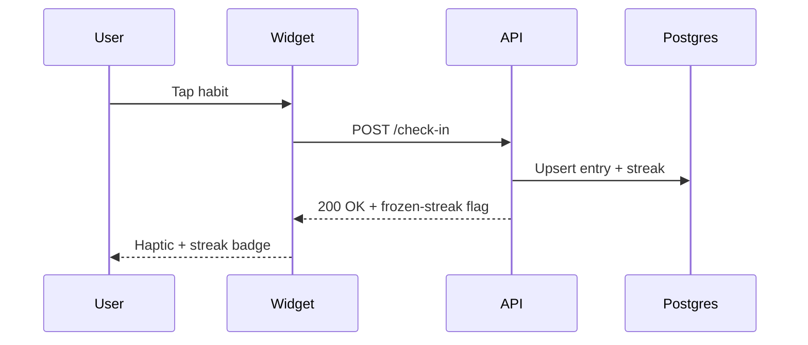

# Example: PRD Generation — SaaS Habit Tracker

A self-contained example of using CouncilForge to turn a short product brief into a
decision-ready Product Requirements Document.

## Input

Paste the following brief into the **Source** panel with the **Text** source type:

```
We want to build a SaaS habit-tracker called Cadence.

Target users: knowledge workers aged 25-45 who already use Notion / Todoist and
are frustrated by streak-shaming apps.

Core behaviors:
- Daily check-in (1 tap from mobile home-screen widget)
- Streaks that freeze rather than reset on missed days
- Weekly review email summarising wins, misses, and a single suggestion
- Social: invite one accountability partner (no public leaderboard)

Constraints:
- Must launch in 90 days, two-person team, $0 marketing budget
- Pricing: free tier (3 habits) + $4/mo Pro (unlimited + analytics)
- Must be GDPR-compliant; no third-party analytics SDKs
```

## Configuration

| Field            | Value                                   |
| ---------------- | --------------------------------------- |
| Source           | Text                                    |
| Doc type         | `AUTO` (engine infers PRD)              |
| Provider mode    | `free` (Groq + OpenRouter free-tier)    |
| Domain pack      | `saas` (optional, biases SaaS vocab)    |
| Council depth    | Default 2-round debate                  |
| Output format    | Markdown                                |

## Expected Output

The pipeline runs all 29 stages and produces a **PRD** with 15+ sections, including:
Title, Summary, Problem statement, Goals, Non-goals, Personas, User journeys,
Requirements, Success metrics, Analytics, Dependencies, Risks, Rollout plan, Open
questions, Acceptance criteria — plus an **Auto-decide rationale** block explaining
why PRD was chosen over BRD/FRD.

A mermaid sequence diagram is rendered inline:



Every requirement row carries a `Confirmed` / `Inferred` / `Assumption` label,
e.g.:

| ID  | Requirement                                   | Label        |
| --- | --------------------------------------------- | ------------ |
| R1  | 1-tap check-in from home-screen widget        | Confirmed    |
| R2  | Streaks freeze, never reset, on a missed day  | Confirmed    |
| R3  | Weekly review email sent every Sunday 18:00   | Inferred     |
| R4  | Accountability partner invite via magic link  | Assumption   |

The **Gaps & Risks** stage surfaces 3 gaps (no offline mode spec, no data-export
flow, undefined partner-offboarding) and 2 risks (free-tier abuse, GDPR export
timeline). The **Confidence** panel reports 78% with a per-section breakdown.

## Explanation

- **AUTO** triggers the Auto-decide stage: the engine reads the brief, sees user
  needs + measurable outcomes + product behavior, and selects `PRD` over `BRD`
  (too business-y) or `FRD` (too functional for the problem framing).
- **free mode** routes long-context stages (Repo Intel, Understand) to OpenRouter
  free-tier, and reasoning stages (Brainstorm, Requirements) to Groq Llama-3.1-70B
  for sub-second latency. Cost: $0. Total runtime: ~45 seconds.
- The **8 council roles** (moderator, productManager, businessAnalyst,
  solutionsArchitect, engineeringLead, qaLead, securityReviewer, uxReviewer)
  debate in 2 rounds; the moderator merges the consensus into the Requirements
  section with labels attached.
- Mermaid is rendered client-side via the bundled `mermaid` package — no
  server-side rendering required.
- Each requirement label drives the **completeness validator**: `Assumption`
  items are flagged for human confirmation before the doc is marked "ready to
  ship".
