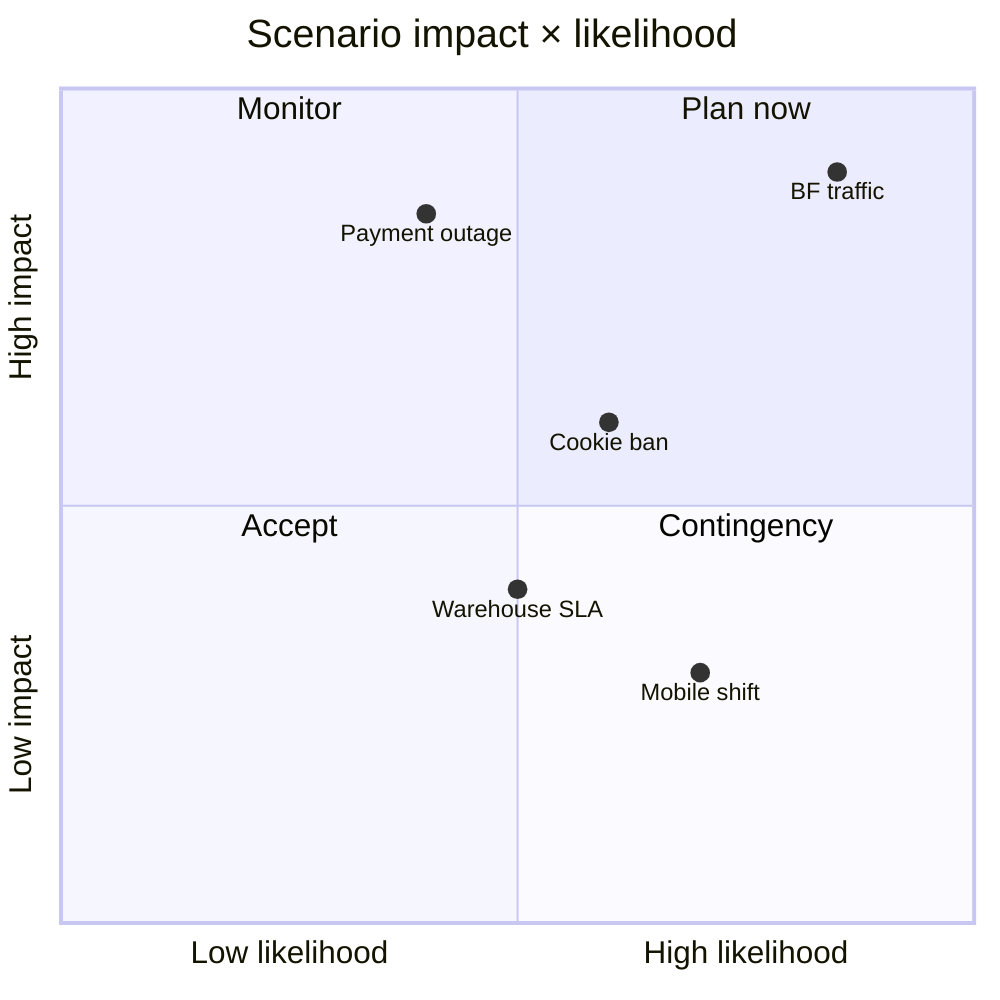

# Example: Scenario Simulation — E-commerce PRD

A self-contained example of running "what-if" scenario simulations against an
existing PRD, producing 7-dimensional impact analysis per scenario.

## Input

First, generate a PRD using the **Text** source with an e-commerce brief
(see `prd-generation.md` for the input format). Once the project exists in
the sidebar, open it and navigate to the **Simulate** tab.

Alternatively, the simulation API can be called directly against any saved
project:

```bash
curl -X POST http://localhost:3000/api/projects/<id>/scenarios \
  -H 'Content-Type: application/json' \
  -d '{"count": 5, "dimensions": ["architecture","business","ux","security","data","ops","financial"]}'
```

## Configuration

| Field               | Value                                                  |
| ------------------- | ------------------------------------------------------ |
| Source              | (existing PRD project)                                 |
| Doc type            | `AUTO` (simulation runs against the PRD as-is)         |
| Provider mode       | `hybrid` (paid reasoning for impact depth)             |
| Scenario count      | 5                                                      |
| Impact dimensions   | 7 (architecture, business, ux, security, data, ops, financial) |
| Output format       | Markdown                                               |

## Expected Output

The simulator generates **3–5 what-if scenarios** calibrated to the PRD's risk
profile. For an e-commerce PRD, typical scenarios are:

1. **What if Black Friday traffic is 10× forecast?**
2. **What if the primary payment gateway has a 4-hour outage on launch day?**
3. **What if a new privacy regulation bans third-party tracking cookies mid-Q3?**
4. **What if the warehouse partner doubles its SLA breach rate?**
5. **What if mobile traffic share shifts from 60% to 85% within 6 months?**

Each scenario carries a **7-dimensional impact matrix**:

```markdown
### Scenario 1: Black Friday traffic 10× forecast

| Dimension     | Impact | Rationale                                            |
| ------------- | ------ | ---------------------------------------------------- |
| Architecture  | High   | Read replicas + CDN cache invalidation strategy fails above 5× |
| Business      | High   | Revenue at risk: ~$420K/hour at peak; SLA penalties  |
| UX            | Medium | Cart latency rises from 800ms to 3.2s; abandonment +12pp |
| Security      | Low    | No new attack surface, but rate-limits must scale     |
| Data          | Medium | Inventory sync lag creates oversell risk              |
| Ops           | High   | On-call rotation insufficient; need 24/7 BF war room  |
| Financial     | High   | +$18K infra spend for 2 weeks; +$0 marginal revenue   |

Mitigations (this quarter):
- Pre-scale to 5× baseline capacity 48h before BF
- Enable queue-mode checkout when inventory sync lag > 5s
- Pre-warm CDN caches for top 1,000 SKUs
```

A consolidated **risk heatmap** renders as a mermaid quadrant chart:



## Explanation

- The **Scenario Simulation** stage lives in `src/lib/impact-propagator.ts` and
  is exposed via `POST /api/projects/[id]/scenarios`. It feeds the saved PRD's
  requirements + risks + assumptions to the council and asks each role to score
  the scenario along its primary dimension (e.g. `solutionsArchitect` scores
  `architecture`, `financeReviewer` scores `financial`).
- **7 dimensions** is the default set matching the `ImpactDimension` union:
  `architecture | business | ux | security | data | ops | financial`. Custom
  dimensions are supported via the `domain-packs` config.
- **hybrid mode** is recommended because each scenario spawns 7 parallel
  role-scoring calls + 1 moderator synthesis; the free-tier Groq rate limit
  (30 req/min) would throttle the run. A paid reasoning provider for scoring
  keeps total runtime under 2 minutes.
- Outputs are stored in `DocProject.scenarios` and rendered in the **Simulate**
  tab as a sortable matrix; the heatmap is regenerated client-side so
  re-weighting likelihoods needs no new LLM call.
- Each mitigation row is tagged with the dimension it addresses, so the
  downstream **Roadmap** stage can convert mitigations into roadmap epics.