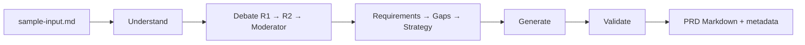

# Example: Skill-only usage — run the council inside your AI IDE

Run the full CouncilForge council **without the web app**, using only the portable, framework-free [`skill/`](../skill) package inside an AI IDE (Claude Code, Cursor, Codex, Kiro, or GitHub Copilot). No Node, no database, no build step — just Markdown the model reads.

## Input

Use the shipped sample brief so you can diff your result against a known-good output:

```
Source: skill/examples/sample-input.md
```

That file contains a compact product brief (a fictional tool). You can also paste your own repo URL, notes, or spec instead.

## Configuration

| Field | Value |
|-------|-------|
| Source | Text (contents of `skill/examples/sample-input.md`) |
| Doc type | `AUTO` (skill's Strategy stage decides) |
| Provider mode | Whatever your IDE is configured with (the skill is model-agnostic) |
| Domain pack | None (base 8-role council) |
| Council depth | Round 1 → Round 2 → Moderator |
| Output format | Markdown |

## Process

1. **Point your IDE at the skill.** Pick your adapter and follow its one-time setup:

   | IDE | Adapter | Setup |
   |-----|---------|-------|
   | Claude Code | [`skill/adapters/claude-code.md`](../skill/adapters/claude-code.md) | `CLAUDE.md` includes `skill/SKILL.md` |
   | Cursor | [`skill/adapters/cursor.md`](../skill/adapters/cursor.md) | `.cursorrules` references `skill/SKILL.md` |
   | Codex | [`skill/adapters/codex.md`](../skill/adapters/codex.md) | `AGENTS.md` references `skill/SKILL.md` |
   | Kiro | [`skill/adapters/kiro.md`](../skill/adapters/kiro.md) | `.kiro/steering/*.md` imports it |
   | GitHub Copilot | [`skill/adapters/github-copilot.md`](../skill/adapters/github-copilot.md) | `.github/copilot-instructions.md` references it |

2. **Read the contract.** [`skill/SKILL.md`](../skill/SKILL.md) is the entrypoint — it defines the stages, roles, templates, and output rules.
3. **Run the pipeline.** Ask the IDE: *"Run the Requirements Intelligence Council on `skill/examples/sample-input.md` and produce the document."* The model loads each `skill/roles/*.md` as a system prompt, runs Round 1 → Round 2 → Moderator, then Requirements → Gaps/Risks → Strategy → Generate → Validate.
4. **Validate the install.** Diff your output against the reference.

```bash
# Compare your generated doc to the shipped reference PRD
diff <(your-generated-output.md) skill/examples/sample-output-prd.md
```

## Expected Output

A single Markdown document (PRD for the sample input) with:

- A title, summary, and 12+ structured sections following [`skill/templates/prd.md`](../skill/templates/prd.md)
- At least one Mermaid diagram
- `Confirmed` / `Inferred` / `Assumption` labels on claims
- Given/When/Then acceptance criteria
- A separate metadata block (traceability, assumptions, confidence, open questions)



The result should closely match [`skill/examples/sample-output-prd.md`](../skill/examples/sample-output-prd.md). Small wording differences are expected (different model); the **structure, labels, and traceability** should hold.

## Why it's useful

- **Zero dependencies.** The council runs anywhere Markdown can be read — no app, no DB, no build.
- **Model-agnostic.** Your IDE supplies the LLM; the skill only specifies what *kind* of model each stage prefers (see [`skill/providers/routing-rules.md`](../skill/providers/routing-rules.md)).
- **Portable & auditable.** The same reasoning that runs in the web app runs in your editor, and the diff-against-reference gives you a fast install check.

If the IDE can't run a multi-stage pipeline, [`skill/SKILL.md` §9](../skill/SKILL.md) explains the minimal one-shot fallback (paste `SKILL.md` + the 8 role files + the template + the quality-score validator in a single prompt).
