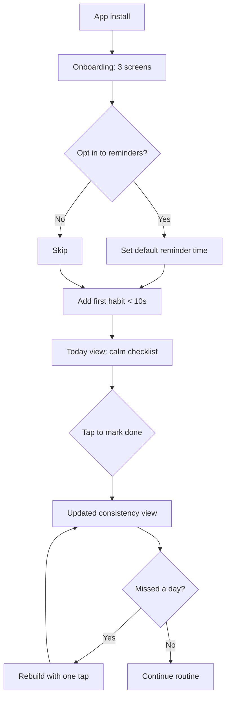
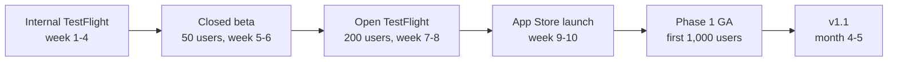

# Sample Output — PRD

> A realistic PRD output demonstrating the structure, tables, Mermaid
> diagram, and Confirmed / Inferred / Assumption labels the pipeline
> produces. This is the expected output when the brief in
> `sample-input.md` is run through the full council pipeline.

---

# Streakline — Product Requirements Doc

| Field    | Value                                    |
|----------|------------------------------------------|
| Version  | 1.0 (Draft)                              |
| Owner    | Founder (solo)                           |
| Status   | In Review                                |
| Date     | 2025-Q1                                  |
| Audience | Mixed business + technical stakeholders  |

## Summary

Streakline is a calm, frictionless habit tracker for busy knowledge
workers. It treats missed days as data, not failure, surfaces patterns
that predict success, and lets users rebuild after a miss with a single
tap. This PRD covers the v1 release: iOS-first launch, free tier with
up to 5 habits, paid tier at $4.99/month or $39/year for patterns and
unlimited habits. **Confirmed** target: 1,000 active users in 90 days
with 40% week-4 retention.

## Problem statement

Existing habit trackers fall into two camps: (1) gamified streak apps
that shame users when they miss a day, causing abandonment within three
weeks; (2) spreadsheets and journals that require discipline to maintain
and don't surface patterns. **Confirmed**: the founder has personally
abandoned four trackers in two years. **Inferred**: this abandonment
pattern is widespread based on app-store reviews of competitor apps
(referenced in the brief's framing, not directly cited). The cost of
the status quo is the user's long-term success — the routines that
compound into outcomes never get built.

## Goals

| ID   | Goal                                                                | Target                                    | Label        |
|------|---------------------------------------------------------------------|-------------------------------------------|--------------|
| G-1  | Validate the "calm tracker" thesis with real users                 | 1,000 active users in 90 days             | Confirmed    |
| G-2  | Prove the product retains users without gamification               | 40% week-4 retention                      | Confirmed    |
| G-3  | Establish a defensible, non-dark-pattern monetization model        | ≥ 5% free-to-paid conversion by day 90    | Assumption   |
| G-4  | Ship accessibility-first from day one                              | VoiceOver + Dynamic Type support at GA    | Confirmed    |
| G-5  | Keep user data under user control                                  | 100% of sync traffic E2E encrypted        | Confirmed    |

## Non-goals

- **Android launch in v1.** Deferred to v2 (Q3). Founder's runway
  constrains the team to one platform. **Confirmed**.
- **Social features, leaderboards, or streak-as-currency mechanics.**
  Out of scope permanently — these define the product's anti-position.
  **Confirmed**.
- **Web app.** Not in scope for v1 or v2; the founder's thesis is a
  mobile-first calm experience.
- **B2B / team plans.** Not in scope; the product is individual-first.
- **Custom habit icons or theming.** Deferred to v1.1.
- **Third-party analytics SDKs that ship user data off-device.** Out of
  scope permanently. **Confirmed**.

## Personas

| Persona              | Role                              | Context                                              | Goals                                          | Frustrations                                    | Success definition                    |
|----------------------|-----------------------------------|------------------------------------------------------|------------------------------------------------|-------------------------------------------------|---------------------------------------|
| Mara (primary)       | Product manager, 32               | Mid-size SaaS company; 5-10 min between meetings     | Meditate, read, mobility, evening prep daily   | Existing trackers shame her after a missed day  | 30-day consistency ≥ 75%             |
| Dev (secondary)      | Solo contracted iOS engineer      | 6-month runway; no backend engineer                  | Ship a defensible v1 on iOS                    | Managing backend complexity solo                | App live in App Store by month 5     |
| Founder (secondary)  | Solo founder                      | Owns product, growth, support; $40K runway           | Validate thesis; find pricing model            | No marketing budget; anti-dark-pattern stance   | 1,000 users in 90 days               |

## User journeys

**Journey 1: First habit (Mara).** Mara installs, sees three onboarding
screens explaining the calm model, skips reminders, adds "Meditate 10
min before 8am" in 8 seconds, sees it on today's checklist, marks it
done. **Confirmed** target: first habit added in under 30 seconds from
install.

**Journey 2: Recovery from a miss (Mara).** Mara misses two days while
traveling. On day 3 she opens the app expecting a streak-loss screen.
Instead she sees her 30-day consistency view (still 78%), a single
"Rebuild" button, and a note: "you complete 80% of habits on days you
open the app before 8am". She taps Rebuild and continues. **Confirmed**:
no streak-loss animation, no guilt language.

**Journey 3: Upgrade to paid (Mara).** After 14 days, Mara has 5 habits
and wants to add a 6th. The app shows a calm upsell: "Patterns and
unlimited habits — $4.99/month or $39/year. Cancel anytime." She
upgrades. **Assumption**: ≥ 5% of week-2 active users upgrade.

## Requirements

### Functional needs

| ID    | Statement                                            | Capability        | Priority | Source     | Label        |
|-------|------------------------------------------------------|-------------------|----------|------------|--------------|
| F-001 | Add a habit in under 10 seconds                      | Habit CRUD        | must     | explicit   | Confirmed    |
| F-002 | Mark a habit done with a single tap                  | Habit tracking    | must     | explicit   | Confirmed    |
| F-003 | Show today's habits as a calm checklist              | Today view        | must     | explicit   | Confirmed    |
| F-004 | Show 30-day consistency view (not streak count)      | Consistency view  | must     | explicit   | Confirmed    |
| F-005 | Show patterns ("80% completion on days when X")      | Patterns engine   | should   | explicit   | Confirmed    |
| F-006 | Rebuild after a miss with a single tap               | Recovery          | must     | explicit   | Confirmed    |
| F-007 | Per-habit reminders, off by default                  | Notifications     | should   | explicit   | Confirmed    |
| F-008 | On-device-first storage; offline works fully         | Offline-first     | must     | explicit   | Confirmed    |
| F-009 | Opt-in E2E encrypted cloud sync                      | Sync              | must     | explicit   | Confirmed    |
| F-010 | Export/import habits and history                     | Data portability  | should   | explicit   | Inferred     |
| F-011 | Email + password auth (no social sign-in)            | Authentication    | must     | inferred   | Inferred     |
| F-012 | Forgot-password and reset flow                       | Authentication    | must     | inferred   | Inferred     |
| F-013 | Account deletion with full data wipe                 | Data subject rights | must  | inferred   | Inferred     |
| F-014 | Free tier limited to 5 habits                        | Monetization      | must     | inferred   | Assumption   |
| F-015 | Paid tier: $4.99/mo or $39/yr, unlimited + patterns  | Monetization      | must     | inferred   | Assumption   |
| F-016 | Restore purchases flow                               | Monetization      | must     | inferred   | Inferred     |
| F-017 | VoiceOver + Dynamic Type support                     | Accessibility     | must     | explicit   | Confirmed    |
| F-018 | Onboarding: 3 screens, calm model explanation        | Onboarding        | must     | inferred   | Inferred     |
| F-019 | Calm upsell when free-tier user tries habit #6       | Monetization      | should   | inferred   | Assumption   |
| F-020 | No third-party analytics SDKs that ship PII off-device | Privacy         | must     | explicit   | Confirmed    |

### Non-functional needs

| ID    | Category       | Statement                                              | Target                          | Label     |
|-------|----------------|--------------------------------------------------------|---------------------------------|-----------|
| NF-1  | performance    | App cold-launch to today view                          | p95 < 1.5s on iPhone 12         | Confirmed |
| NF-2  | reliability    | Offline operations never block the user                | 100% of habit ops work offline  | Confirmed |
| NF-3  | security       | Sync traffic E2E encrypted (user-held keys)            | AES-256-GCM, user-controlled    | Confirmed |
| NF-4  | privacy        | No PII leaves device without explicit opt-in           | 0 off-device PII events         | Confirmed |
| NF-5  | accessibility  | VoiceOver + Dynamic Type + contrast                    | WCAG 2.2 AA where applicable     | Confirmed |
| NF-6  | observability  | First-party, anonymous crash + usage telemetry         | Opt-in, no PII, on-device agg   | Confirmed |
| NF-7  | scalability    | Managed backend handles 10K concurrent users           | Serverless auto-scale           | Inferred  |
| NF-8  | maintainability| Solo-engineer-bus-factor mitigation                    | Doc'd runbooks + codified infra | Inferred  |

## Success metrics

| Metric                            | Definition                                        | Baseline | Target       | Cadence  | Owner    |
|-----------------------------------|---------------------------------------------------|----------|--------------|----------|----------|
| Active users                      | Users with ≥ 1 habit marked done in last 7 days   | 0        | 1,000 @ 90d  | Weekly   | Founder  |
| Week-4 retention                  | % of week-1 actives still active in week 4        | n/a      | 40%          | Weekly   | Founder  |
| Free-to-paid conversion           | % of week-2 actives on paid plan                  | 0%       | 5%           | Monthly  | Founder  |
| First-habit time                  | Median seconds from install to first habit added  | n/a      | < 30s        | Daily    | Engineer |
| Crash-free sessions               | % of sessions without a crash                     | n/a      | ≥ 99.5%      | Daily    | Engineer |
| Accessibility audit pass rate     | VoiceOver + Dynamic Type test pass rate           | n/a      | 100% at GA   | Per release | Engineer |

## Analytics

**Events to instrument** (all anonymous, on-device aggregated, opt-in
for cloud upload):
- `app_open`, `habit_added`, `habit_completed`, `habit_missed`,
  `rebuild_tapped`, `pattern_viewed`, `upsell_shown`, `upsell_converted`,
  `sync_enabled`, `reminder_enabled`, `crash`.

**Funnels:**
- Install → First habit → Day-7 active.
- Upsell shown → Upsell converted.
- Reminder opt-in → 14-day retention.

**Privacy guardrails:**
- No PII in events. Habit titles are never sent off-device.
- Cloud upload is opt-in and aggregates only.
- Crash reports redact habit titles and timestamps.

## Dependencies

| Dependency                                | Owner    | Risk if delayed                          | Label     |
|-------------------------------------------|----------|------------------------------------------|-----------|
| Apple App Store review                    | Founder  | 1-2 week review slip                     | Confirmed |
| Managed backend (Supabase or Firebase)    | Engineer | Vendor choice locks sync architecture    | Inferred  |
| Apple StoreKit 2 for subscriptions        | Engineer | Restore-purchases edge cases             | Inferred  |
| E2E encryption library (user-held keys)   | Engineer | Implementation complexity for solo eng   | Confirmed |
| Accessibility audit tooling (Xcode)       | Engineer | Audit gaps found late                    | Confirmed |

## Risks

| ID   | Category   | Risk                                                       | Likelihood | Impact | Severity | Mitigation                                            | Owner    |
|------|------------|------------------------------------------------------------|------------|--------|----------|-------------------------------------------------------|----------|
| R-1  | technical  | E2E encryption implementation too complex for solo engineer| medium     | high   | high     | Use a vetted library (e.g. Threads-style); spike in week 1 | Engineer |
| R-2  | business   | Pricing model doesn't convert                              | medium     | high   | high     | Soft launch with pricing A/B; pivot to one-time if needed | Founder  |
| R-3  | adoption   | "Calm" positioning doesn't acquire users organically       | medium     | high   | high     | Content-led growth (founder writes about the thesis) | Founder  |
| R-4  | technical  | Backend vendor lock-in (Supabase/Firebase)                 | low        | medium | medium   | Keep sync layer abstracted behind a repository interface | Engineer |
| R-5  | operational| Solo-engineer bus factor                                   | high       | high   | high     | Codify infra, runbooks, on-call rotation founder as backup | Engineer |
| R-6  | security   | E2E encryption key recovery lost → user data loss          | medium     | high   | high     | Recovery code flow; warn explicitly at opt-in         | Engineer |
| R-7  | delivery   | Runway ($40K / 6mo) insufficient to reach 1,000 users      | medium     | high   | high     | Cut scope to 4 habits free; ship v1 by month 5        | Founder  |
| R-8  | adoption   | App Store category saturation (50+ habit trackers)         | high       | medium | medium   | Anti-positioning: "the calm tracker" as differentiator| Founder  |

## Rollout plan

| Phase                         | Gate to next phase                        | Rollback trigger                       |
|-------------------------------|-------------------------------------------|----------------------------------------|
| Internal TestFlight           | Crash-free ≥ 99%; onboarding < 30s        | Crash rate > 1%                        |
| Closed beta (50 users)        | Week-1 retention ≥ 50%; ≥ 1 upgrade       | Privacy complaint or data-loss incident|
| Open TestFlight (200 users)   | Week-2 retention ≥ 45%; crash-free ≥ 99.5%| P0 bug in sync or E2E encryption       |
| App Store launch              | 100 active users in week 1                | Crash-free < 99%                       |
| Phase 1 GA (first 1,000)      | 1,000 active users in 90 days             | Retention < 30% week-4                 |

**Feature flags:**
- `patterns_engine` — off until closed beta validates consistency view.
- `paid_tier` — off until open TestFlight; on at App Store launch.
- `cloud_sync` — opt-in per user from day one.

**Communication plan:** Founder writes a launch essay on the calm-tracker
thesis; shares in 3 communities (Indie Hackers, Product Hunt, one
Slack/Discord community). No paid acquisition in v1.

## Open questions

| Question                                                  | Why it matters                            | Who decides  | Blocks           | Label        |
|-----------------------------------------------------------|-------------------------------------------|--------------|------------------|--------------|
| Final pricing: $4.99/mo vs $2.99/mo?                      | Directly affects conversion and revenue   | Founder      | Paid tier launch | Assumption   |
| Backend choice: Supabase vs Firebase vs roll-your-own?    | Lock-in vs flexibility vs solo-eng time   | Engineer     | Sync feature     | Inferred     |
| Patterns engine: ML or rule-based?                        | Complexity, explainability, solo-eng load | Engineer     | Patterns feature | Open Question|
| Should free tier be 5 habits or 3 habits?                 | Conversion vs generosity tradeoff         | Founder      | Launch pricing   | Assumption   |
| Recovery-code flow: paper backup or device-to-device?     | UX complexity vs key-loss risk            | Engineer     | E2E encryption   | Open Question|
| Onboarding: how to teach calm notification model?         | Differentiator; risk of feature hiding    | Founder + UX | v1 launch        | Open Question|

## Acceptance criteria

| ID   | Given                                | When                                  | Then                                              | Req ID  |
|------|--------------------------------------|---------------------------------------|---------------------------------------------------|---------|
| AC-1 | A new user with the app installed    | They complete onboarding              | They can add their first habit in < 30s total     | F-001   |
| AC-2 | A user with one habit on today view  | They tap the habit                    | It is marked done in < 200ms, no full-screen ad   | F-002   |
| AC-3 | A user who missed 2 days             | They open the app                     | They see consistency view (no streak-loss screen) | F-004   |
| AC-4 | A user who missed 2 days             | They tap "Rebuild"                    | Their history is preserved, consistency continues | F-006   |
| AC-5 | A user with 5 free-tier habits       | They try to add a 6th                 | They see a calm upsell, not a hard block          | F-019   |
| AC-6 | A user with cloud sync off           | They mark a habit done on a plane     | The change is saved locally and syncs on reconnect| F-008   |
| AC-7 | A user with VoiceOver enabled        | They navigate today view              | Every element has a meaningful label             | F-017   |
| AC-8 | A paid subscriber                    | They tap "Restore Purchases"          | Their subscription is restored without re-charge | F-016   |
| AC-9 | A user who deletes their account     | They confirm deletion                 | All on-device and synced data is wiped           | F-013   |
| AC-10| Any user                             | The app crashes                        | Crash report is redacted of PII before any upload| NF-6    |

---

## Notes on this sample

This PRD demonstrates the skill's required output characteristics:
- **Markdown only**, with `#` / `##` / `###` heading hierarchy.
- **Tables** for goals, personas, requirements, metrics, risks, ACs.
- **Mermaid diagrams** (user journey flowchart + rollout flowchart).
- **Inline labels**: `Confirmed`, `Inferred`, `Assumption`, `Risk`,
  `Gap`, `Open Question` used throughout.
- **Testable acceptance criteria** in Given/When/Then, linked to
  requirement IDs.
- **Traceability**: business goals → requirements → ACs → owners visible
  across tables.
- **No invented facts**: pricing is labeled `Assumption`; backend choice
  is `Inferred`; open questions are explicit, not hidden.

The metadata stage (separate from this document) would additionally
produce: assumptions list, confidence ratings per area, open questions
as structured data, next actions, and a full traceability matrix.
